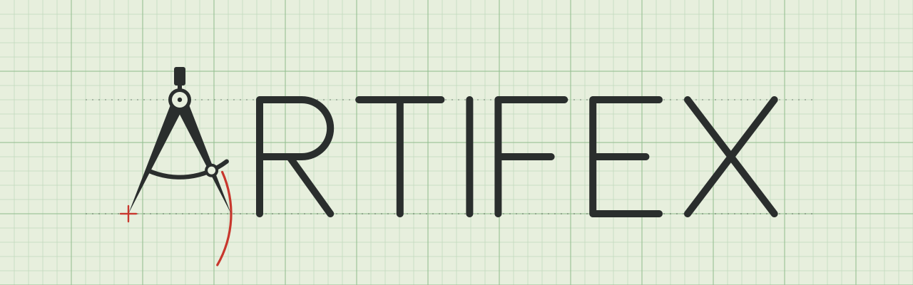

# Artifex

> *Latin: craftsman, artist, maker*

A collection of Claude Code skills for enhanced productivity and intelligent automation, created largely by Claude.

## What is Artifex?

Artifex is my collection of skills for Claude Code.

## Available Skills

### skill-finder
**Description:** Discover and vet Claude Code skills from repositories and marketplaces with built-in security reviews.

**Features:**
- Searches official Anthropic repositories, community sources, and the Superpowers marketplace
- Performs mandatory security assessments on all found skills
- Provides detailed security guidance for safe skill adoption
- Rates skills as SAFE, REVIEW NEEDED, or UNSAFE

**Location:** `skills/skill-finder/`

**Slash command:** `/artifex:skill-finder`


### project-namer
**Description:** Use Claude to generate project names

**Features:**
- Has a questionnaire that starts with a description of the project or
  initiative
- It will ask about languages to use, themes/vibe, whether to consider invented
  words, and other relevant information.
- Produces a details list of words with their etymlogy, pronounciation, justification for inclusion, then a top 3 recommendations list.
- Optional themed word lists: periodic table elements and meteorological terms, each with word origins and name-collision warnings.
- Two-word operation-style codenames ("Operation Lead Balloon"), with the register set by the tone answer: solemn, neutral, deadpan, or dry technical.

**Location:** `skills/project-namer/`

**Slash command:** `/artifex:project-namer`

### arxiv-search
**Description:** Search and retrieve academic papers from ArXiv (arxiv.org).

**Features:**
- Search by keywords, authors, categories, or ArXiv IDs
- Dual approach: Direct API access or bundled Python script
- Support for boolean operators and advanced queries
- Retrieve paper metadata, abstracts, and PDF links
- Comprehensive API reference with full category taxonomy
- No dependency on unstable MCP servers

**Location:** `skills/arxiv-search/`

**Slash command:** `/artifex:arxiv-search`

## Synoptix: multi-agent code review

*Synoptix* is the working brand for the cross-agent review skill below, which ships as the `cross-agent` plugin. The name is from *synoptic*, Greek for "seeing all together": a synoptic chart puts many independent observations on one map. It is reserved as the project name if this skill is ever split into its own repository.

### consensus-review
**Description:** Codex, agy (the Antigravity CLI), and Claude review the same target independently, debate the disagreements, and report a decision for every proposed change. Also runs a review from one outside agent alone.

**Features:**
- Reviews uncommitted changes, a branch diff, or an OpenSpec change
- Parallel, isolated reviews in a shared finding format, with every finding verified against the code or spec before it counts
- One debate round on disputed and unverified items, by resuming each reviewer's session
- Decision table with justifications, unresolved items, and an ordered final changeset
- Reviewers run read-only: Codex in a read-only sandbox, agy in sandbox and plan mode, never with permission bypass
- Checks for `codex`, `agy`, and `jq` or `python3` before starting, says what is missing, and carries on with the reviewers that are available
- Gives reviewers the change and a repository file index in one file, so agy, which cannot list directories when headless, does not guess paths
- Prints progress lines while reviewers run. If agy runs out of time, resumes its conversation once to collect the findings it had
- Reports why a run failed, how long it ran, and the tokens used. `REVIEW_DEBUG=1` keeps the exact command line for reproducing a run by hand
- Saves each reviewer's review and the combined decisions under `.agent-reviews/<kind>-<label>-<timestamp>/`, in files named for the change, such as `openspec-review-codex-add-user-auth.md` and `openspec-review-consensus-add-user-auth.md`. Prompts and raw responses go in its `work/` subdirectory
- Asks once whether to gitignore all review artifacts or keep the reviews and ignore only the working files
- Never edits files without confirmation

**Dependencies:**

| Tool | Needed | Used for |
|---|---|---|
| `git` | Yes | Diffs, the file index, and the check that a review changed nothing |
| `codex` (OpenAI Codex CLI), installed and signed in | For Codex reviews | The Codex reviewer. Verified with codex-cli 0.171.0 |
| `agy` (Antigravity CLI), installed and signed in | For agy reviews | The agy reviewer. Verified with agy 1.5.15 |
| `jq` or `python3` | For agy reviews | Reading agy's output |
| `openspec` | Optional | Validating an OpenSpec change before it is reviewed |
| `gh` (GitHub CLI) | Optional | Adding the pull request number to a code review's file names |

At least one of `codex` and `agy` is needed for an outside review. The skill checks for all of these before it starts and says what is missing.

**Location:** `skills/consensus-review/`

**Slash command:** `/cross-agent:consensus-review`

## Installation

Artifex is a Claude Code plugin marketplace. Install all skills in one shot from inside Claude Code:

```
/plugin marketplace add github:jeffbeard/artifex
/plugin install artifex@artifex
```

The cross-agent review skill (`consensus-review`) ships as a separate plugin, `cross-agent`:

```
/plugin install cross-agent@artifex
```

The install asks for a scope. A plugin installed at user scope is available in every project. A plugin installed at project scope is available only in the project where you installed it, so run the install again in each other project that needs it.

To pull updates later:

```
/plugin marketplace update artifex
/reload-plugins
```

The first command fetches the latest marketplace from GitHub. The second loads the new version into the running session; restarting Claude Code does the same. Sessions in other projects need their own reload or restart.

If a plugin still shows the old version after that, uninstall and reinstall it:

```
/plugin uninstall artifex@artifex
/plugin install artifex@artifex
```

### Manual installation (alternative)

You can still copy individual skill directories if you prefer not to use the plugin system:

```bash
# Personal (available across all projects)
cp -r skills/skill-finder ~/.claude/skills/

# Project-local (shared via git)
cp -r skills/skill-finder ./.claude/skills/
```

## Using Skills

Once installed, Claude Code automatically discovers and uses skills based on your requests. For example:

- "Find skills about file organization" → Triggers **skill-finder**
- "Ask agy to review the current OpenSpec change" → Triggers **consensus-review**
- "Ask codex and agy to review this before we open a PR and come to a consensus" → Triggers **consensus-review**
- Skills load only when needed, keeping context usage efficient

### Slash commands

Each skill can also be run by name. The command is the plugin name, a colon, then the skill name:

| Skill | Plugin | Slash command |
|---|---|---|
| skill-finder | `artifex` | `/artifex:skill-finder` |
| project-namer | `artifex` | `/artifex:project-namer` |
| arxiv-search | `artifex` | `/artifex:arxiv-search` |
| consensus-review | `cross-agent` | `/cross-agent:consensus-review` |

Text after the command is passed to the skill as the request:

```
/cross-agent:consensus-review codex and agy, review the current OpenSpec change
```

Type `/artifex` or `/cross-agent` in Claude Code to see the commands from the plugins you have installed. Skills copied in by hand (see Manual installation) have no plugin prefix, for example `/skill-finder`.


## Contributing

Have a useful skill to share? Contributions are welcome!

1. Fork this repository
2. Create a new skill in `skills/your-skill-name/`
3. Include a `SKILL.md` with proper frontmatter
4. Submit a pull request


## Resources

- [Claude Code Documentation](https://docs.claude.com/en/docs/claude-code/)
- [Official Anthropic Skills](https://github.com/anthropics/skills)
- [Superpowers Marketplace](https://github.com/superpowers-ai/superpowers-marketplace)

## License

MIT License - See LICENSE file for details

## Etymology

**Artifex** (Latin) combines *ars* (skill, art) and *facere* (to make). It perfectly captures the essence of this project: crafting tools that make Claude Code more skillful and artful in its assistance.
